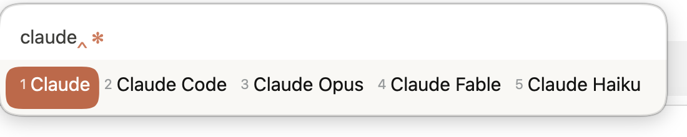
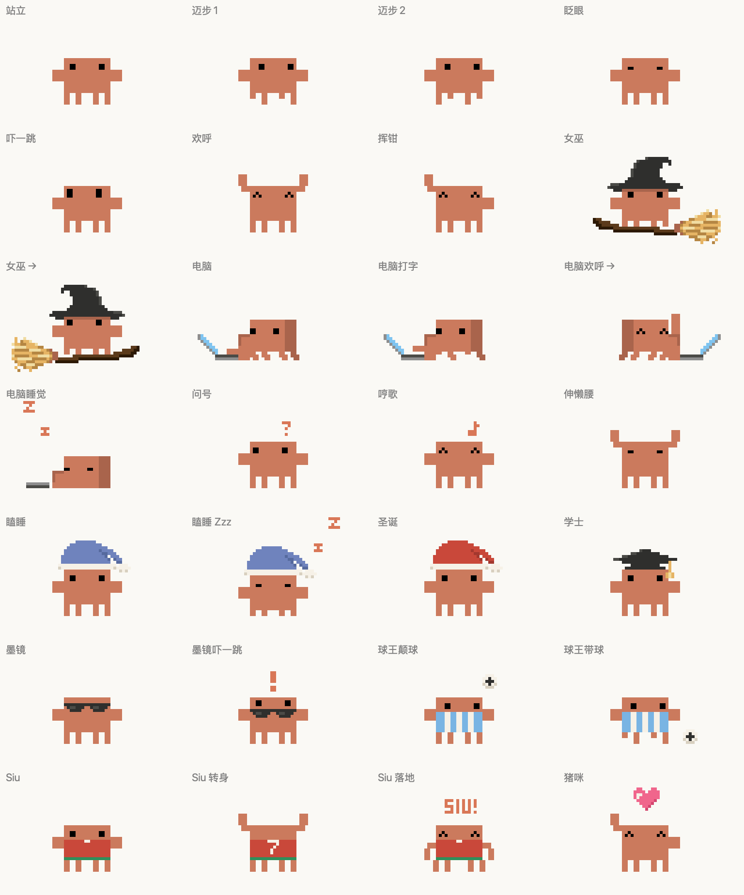
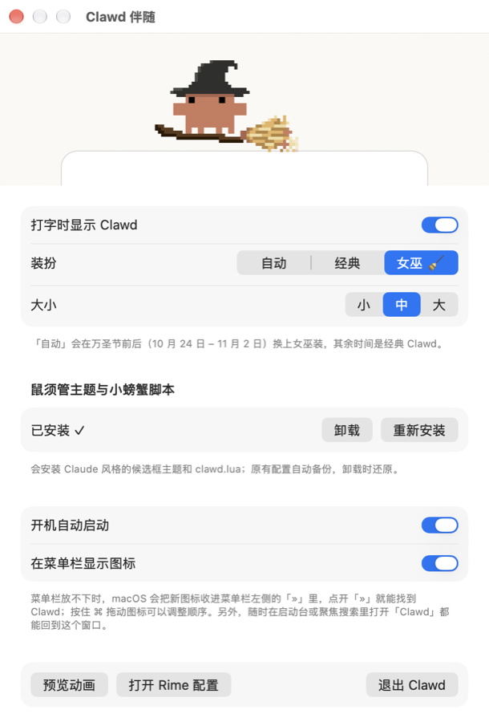

<div align="center">



# rime-clawd

**让 Claude 的像素小螃蟹 Clawd 住进你的 Rime 输入法**

Claude 风格的候选框主题 + 一个蹲在候选框上、跟着光标爬的像素小螃蟹

macOS（鼠须管 Squirrel）· Windows（小狼毫 Weasel，测试版）

&nbsp;&nbsp;

<sub>左：经典 Clawd　右：万圣节限定女巫装（10/24 – 11/2 自动换装）</sub>

</div>

---

## 功能

- **Claude 风格主题**：象牙白纸面、白色输入栏、Claude 橙选中胶囊，浅色 / 深色自动切换，带一点点毛玻璃。
- **会动的 Clawd**：站在候选框上沿、正对光标。你每打一个字母，它就横着爬一步。
- **一键安装**：主题和脚本都打包在 App 里，点一下「安装到鼠须管」就配置好。原配置自动备份，卸载时还原。
- **开机自启、几乎不耗电**：只在你打字时动画，空闲时 CPU 占用为 0。
- **Apple 芯片和 Intel Mac 都能用**（通用二进制，macOS 13+）。
- **也有 Windows 版**（小狼毫，测试版）：单个 77KB 的 exe，安装方法见下面的 [Windows 安装](#windows小狼毫测试版)。

<p align="center"></p>

### Clawd 的动作

| 你在做什么 | Clawd 在做什么 |
|---|---|
| 打字 | 横着爬到光标上方，迈腿、眼睛朝前看 |
| 停下来挑候选 | 东张西望、眨眼、钳子一沉一浮地「呼吸」 |
| 按退格 | 头顶冒出「!」，吓得往上一弹 |
| 打出 `claude` | 双钳轮流挥舞，冒小火花 |
| 上屏 | 举起双钳跳一下，撒一圈 ✻ 火花 |
| 编码很长 | 冒汗 |
| 万圣节前后 | 戴上女巫帽骑扫帚，身后拖着一串火花 |

<p align="center"></p>

## 安装

### macOS（鼠须管）

**前提**：已经装好 [鼠须管](https://rime.im)（1.0 以上，在 1.1.2 上测试）和 [雾凇拼音](https://github.com/iDvel/rime-ice)。

1. 到 [Releases](../../releases) 下载 `Clawd-x.y.z.dmg`，把 **Clawd** 拖进「应用程序」。
2. 第一次打开时，macOS 会提示「无法验证开发者」（这个 App 没有付费的 Apple 开发者签名）。处理方法二选一：
   - 打开「系统设置 › 隐私与安全性」，在页面下方点「仍要打开」；或者
   - 在终端执行：
     ```bash
     xattr -dr com.apple.quarantine /Applications/Clawd.app
     ```
3. 打开后会弹出设置窗口：点 **「安装到鼠须管」**，等鼠须管重新部署完，随便打几个字就能看到 Clawd。

<p align="center"></p>

之后想回到设置窗口：在启动台或聚焦搜索（⌘ 空格）里打开「Clawd」，或者点菜单栏上的小 Clawd 图标。

> 菜单栏图标太多时，macOS 会把新图标收进菜单栏左侧的「»」里。点开「»」就能找到它。

### Windows（小狼毫，测试版）

**前提**：Windows 10 或 11，已经装好 [小狼毫](https://rime.im)（0.15 以上，在 0.17 系列上开发）和 [雾凇拼音](https://github.com/iDvel/rime-ice)。

1. **下载**：到 [Releases](../../releases) 下载 `Clawd-windows-x.y.z.zip`。
   - 想先试用测试版，可以打开 [Actions › Windows build](../../actions/workflows/windows.yml)，点最新一次成功的构建，在页面底部的 Artifacts 里下载 **Clawd-windows**（需要登录 GitHub）。
2. **放好**：解压出 `Clawd.exe`，放进一个固定的文件夹，比如 `D:\Tools\Clawd\`。开机自启会记住这个位置，之后别再移动它；要换位置的话，先在设置里关掉开机自启，移动后再打开。
3. **第一次打开**：双击 `Clawd.exe`。如果 Windows 提示「Windows 已保护你的电脑」，点「更多信息」，再点「仍要运行」（这个程序没有付费的代码签名）。
4. **安装到小狼毫**：打开后会弹出设置窗口，点 **「安装到小狼毫」**。它会安装 Claude 风格的小狼毫主题和小螃蟹脚本，原来的配置自动备份到 `%APPDATA%\Rime\backup_clawd_<时间>\`。
5. **试一下**：等小狼毫重新部署完（右下角会有提示），切到小狼毫随便打几个字，Clawd 就会站在候选框上。

之后想回到设置窗口：双击屏幕右下角通知区域里的小 Clawd 图标（图标可能收在「^」里），或者再打开一次 `Clawd.exe`。

**如果 Clawd 没有正好站在候选框上**：不同版本的小狼毫，候选框窗口四周留的空白可能不一样。在设置窗口的「位置微调」里调「左右」「上下」就行，单位是像素（按 100% 缩放计算），调完立刻生效。

**如果打字时完全看不到 Clawd**：
- 确认设置窗口里「打字时显示 Clawd」是勾上的，「小狼毫主题与小螃蟹脚本」显示「已安装 ✓」。
- 在小狼毫的托盘菜单里点一次「重新部署」。
- 还是不行的话，把 `%LOCALAPPDATA%\ClawdCompanion\live.log` 的内容贴到 [issue](../../issues) 里，能看出卡在哪一步。

## 使用其他输入方案

自动安装目前只会给**雾凇拼音**（`rime_ice`）挂上小螃蟹脚本。用其他方案（比如朙月拼音 `luna_pinyin`）的话，先在设置里点一次「安装到鼠须管 / 小狼毫」装好主题和 `lua/clawd.lua`，然后在用户文件夹（macOS 是 `~/Library/Rime/`，Windows 是 `%APPDATA%\Rime\`）的 `<方案名>.custom.yaml` 的 `patch:` 下面加上这几行（见 [`Resources/rime/schema.custom.snippet.yaml`](Resources/rime/schema.custom.snippet.yaml)），再重新部署：

```yaml
patch:
  "engine/translators/+":
    - lua_translator@*clawd
  clawd:
    style: companion   # companion | clawd | crab | emoji | off
    sparkle: true      # 光标后面的 ✻ 火花
```

如果文件里已经有 `"engine/translators/+"`，就别再写一个新键了，直接在它的列表里加一行 `- lua_translator@*clawd`。

`clawd/style` 的几种取值：

| 取值 | 效果 |
|---|---|
| `companion`（默认） | 像素 Clawd 由伴随程序（Clawd.app / Clawd.exe）画在候选框上沿 |
| `clawd` | 不装 App 也能用：用方块字符在拼音下方拼出两行高的 Clawd |
| `crab` | 单行颜文字 `V(•ᴗ•)V` |
| `emoji` | 🦀 |
| `off` | 关闭 |

## 自定义主题

主题文件在 macOS 上是 `~/Library/Rime/squirrel.custom.yaml`，在 Windows 上是 `%APPDATA%\Rime\weasel.custom.yaml`，里面每个颜色都写了注释。注意颜色写法是 `0xAABBGGRR`（BGR 顺序，AA 是不透明度）。比如在 macOS 上想要更「玻璃」，把 `back_color` 开头的 `F2` 调小（比如 `C0`）。改完点「重新部署」。

## 工作原理

鼠须管的候选框只能显示文字，画不了图片，所以 Clawd 由一个独立的小 App 来画：

```
按键 ─▶ librime ─▶ lua/clawd.lua ──写入──▶ ~/Library/Caches/ClawdCompanion/state
                       │                                   │（文件变化通知）
                       └─ 在光标后放 ✻ 火花                  ▼
                                                    Clawd.app
                                    ├─ 找到鼠须管候选框窗口的位置（CGWindowList）
                                    ├─ 用和候选框相同的字体量出光标横坐标
                                    └─ 在一个透明、点击穿透的悬浮窗里逐像素画出 Clawd
```

- Clawd 的造型由代码一格一格画出来（本体 24×16 像素），不用图片素材，所以在 Retina 屏上始终清晰，每个部位都能单独动。
- 只有你在打字时才以 60 帧刷新；不打字时不跑任何定时器。
- Windows 版原理相同：状态文件在 `%LOCALAPPDATA%\ClawdCompanion\state`，候选框窗口通过窗口类名 `WeaselPanel` 找到，Clawd 画在一个透明、点击穿透的分层窗口里。
- 排查问题可以看 `live.log`（macOS 在 `~/Library/Caches/ClawdCompanion/`，Windows 在 `%LOCALAPPDATA%\ClawdCompanion\`）。

## 从源码构建

需要 Xcode 或 Command Line Tools（`xcode-select --install`）。

```bash
./build.sh            # 构建 build/Clawd.app（通用二进制）
./build.sh install    # 构建并安装到 ~/Applications，然后启动
./build.sh dist       # 打包 dist/Clawd-x.y.z.dmg 和 .zip
./build.sh demo       # 重新录制 docs/ 里的演示 GIF（需要 python3 + Pillow）
```

**Windows**：不需要安装任何东西，Windows 自带 .NET Framework 4.x 的 C# 编译器。在仓库里双击 `windows\build.bat`，产物是 `windows\dist\Clawd.exe`（主题和 `clawd.lua` 都打包在 exe 里）。

造型在两个平台上必须逐像素一致：`windows/sprites.ref.txt` 由 macOS 版 `Clawd --dump-sprites` 生成，GitHub Actions 每次在 Windows 上构建后都会用 `Clawd.exe --dump-sprites` 导出并比对，不一致就判构建失败。

## 卸载

1. 打开 Clawd 的设置窗口，点「卸载」：删除小螃蟹脚本、还原原来的主题。
2. 关掉「开机自动启动」，点「退出 Clawd」，再把 Clawd.app 拖进废纸篓（Windows 上删掉 `Clawd.exe`）。
3. Windows 版的设置保存在注册表 `HKEY_CURRENT_USER\Software\ClawdCompanion`，可以一起删掉。

## 已知限制

- 候选框上方就是你正在输入的那一行，Clawd 会挡住光标右边一小块。可以在设置里调成「小」，或者关掉。
- 为了让输入栏显示在候选框里，主题使用 `inline_preedit: false`：拼音显示在候选框顶部，不直接显示在文本框里。
- 自动配置只支持雾凇拼音；其他方案请按上面的方法手动添加几行。
- Windows 版还在测试中：小狼毫没有毛玻璃效果，主题是实色背景；Clawd 的位置可能需要用「位置微调」修正几个像素。

## 声明

这是一个**非官方的粉丝项目**，与 Anthropic 没有任何关联，也没有得到 Anthropic 的认可。Claude 和 Clawd 是 Anthropic 的商标和角色形象，版权归 Anthropic 所有；本项目中的 Clawd 像素造型是照官方形象重绘的同人作品，仅供个人学习和娱乐。

代码以 [MIT 许可证](LICENSE) 开源（不包括 Clawd 角色形象本身）。

感谢 [Rime / 鼠须管](https://github.com/rime/squirrel)、[librime-lua](https://github.com/hchunhui/librime-lua) 和 [雾凇拼音](https://github.com/iDvel/rime-ice)。
